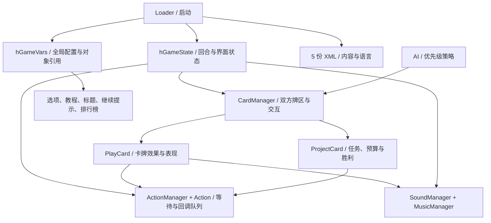

# 程序架构与完整运行流程

本文件承接[总报告](analysis.md)。代码依据为完整 [C#](../local/decompiled/Loader.cs)、[IL](../local/il/Assembly-CSharp.il) 与 [token/调用索引](../evidence/code-index.json)。以下均为静态分析。

## 构建与启动

唯一构建场景的原路径为 `Assets/Scene24.unity`，发布场景存于 `mainData`。没有 AssetBundle/Addressables/IL2CPP 文件；加载内容通过旧版 `Resources.Load`。

`00 Core`（mainData:174）上有 Loader、CardManager、AI、SoundManager、MusicManager，另有 AudioListener/AudioSource。Loader.Start 初始化语言、全局状态和全局变量；首个就绪 Update 获取命名场景对象、加载卡牌 XML、建立按钮，随后每帧驱动 hGameState 与 hGameVars。类名、对象名和业务方法均保留，便于追踪。

这是以静态服务和场景对象为中心的单程序集架构。`GameObject.Find`、`GetComponent`、字符串资源名与按编号访问位置锚点是主要连接方式，没有独立领域模型、依赖注入层或数据库。

## 状态机与结算顺序

18 个公开 ST 常量全部登记在 [content-summary.json](../evidence/content-summary.json)。主流程为：

1. `0 LOADING → 1 TITLE_CT → 2 START`。首次展示标题；重载/编辑器分支可跳过标题。START 复制两副牌组并准备淡入和音乐。
2. `9 TUTORIAL → 10 INI_PROJECT_SELEC → 11 INI_PREPARE_HAND → 12 INI_TITLE_START`。教程可关闭，两页；项目从 28 个中为双方随机取不同 ID；每方初始发五张牌。项目依次展开展示后放回桌面。
3. `15 TITLE_PLAYER → 16 RESOLVE_SPECIALS → 18 RESOLVE_TABLE_DEV → 25 GET_CARDS → 26 PLAY_CARDS`。先显示回合标题；自动处理可用修复卡，再推进当前方未阻断员工的工作，之后补牌，最后允许出牌。自动修复发生在员工推进之前，直接影响本次员工能否工作。
4. `17 RESOLVE_TABLE_NEG → 30 NEXT_TURN → 15`。出牌结束后，推进当前方受到的持续负面事件时长；更新项目统计，再交换玩家。回到玩家 0 时周数增加；两次半回合算一周。
5. `50 END_GAME`。项目完成后锁定操作、清牌、胜者盖发布章/败者取消章、播放胜败音乐、展示预算与排行榜，再提供重开。
6. `80 PAUSE` 保存前态，恢复时不重新执行前态 OnEnter。`-1 RELOAD` 淡出并重新加载同一场景；`-2 QUIT` 淡出退出。长按 Escape 超过三秒触发退出；松开取消计时。

证据：`hGameState.OnEnter` token `06000136`、`NextState` `06000138`；`Loader.LoadProjectCards` `06000117`。数值 ID 不等于执行顺序，尤其是 18 在 17 前执行。

## 双方数据与动作队列

`CardManager.PlayersCards` 为每方维护牌堆、手牌、工作员工、负面事件、弃牌、项目对象/项目编号。卡牌实例来源于模板 `20 CardBase`，项目来源于 `25 CardProjectBase`；发布时原模板和未选项目隐藏。95 定义与两方克隆实例是不同层，不能把静态场景中仅一个 PlayCard 误判成只有一张卡。

`PlayCard` 持有 ID、类型、工作回合数、当前回合、所属玩家、目标/功能、修复 ID、选择状态、折叠/展开/盖章/灯效/音效和 ActionManager。`ProjectCard` 持有五组 `[完成量,目标量]`、预算、统计曲线、任务标记、选择按钮和表现状态。

Action 支持位置/统一缩放插值、固定延时、0/1/2 整数参数回调和返回 bool 的等待函数。ActionManager 用列表/游标和 `m_bFinishForNext` 控制等待或同帧并行启动；它是 ScriptableObject，但运行时手动 Update，不是 Unity 协程。主状态、卡牌、项目、AI 等有各自队列；“所有对象平静”检查用于衔接。Fast Mode 的 1.5 倍作用于 `fGetMultDT` 的动作/延时，很多 UI 动画用 `fGetDT` 保持普通速度，不能将所有计时统一乘 1.5。

## AI 决策

AI 是手写启发式，未发现模型、训练、搜索树或难度分级。每次可行动时重新分析己方剩余任务、在场员工、手牌可用性，以及对方各部门进度/工作员工。

`AI.UpdateLogic`（06000106）依次考虑总部干预、修复、即时员工干预、开发员工、正面增益、持续阻断；前面已加入动作则后面不再选择。部门优先级考虑未完成任务减 `0.75 × 在场员工数`，并结合手里有没有员工。员工干预选择对方重要工作部门，剩余工作回合参与挑选；增加任务优先对方剩余量较多部门，重开任务从已有完成量中选。增益优先减目标、开放部门、全部完成、前进一回合；阻断考虑对方正在工作的部门或全体阻断。

每次展示/行动前随机等待 0.1–1 秒。自动暂停开启时，AI 展示卡牌后等待玩家“继续”，用于阅读信息，属于表现节奏。项目、抽牌、音乐变体和延时共用 UnityEngine.Random；没有持久化随机种子或重放记录。

## 界面、相机和输入

单个正交 Camera（mainData:942），orthographic size 约 5.4；默认 1920×1080、全屏/原生分辨率，配置支持 4:3 与 16:9、不可缩放窗口、后台不继续运行。游戏按宽高比启用两套背景、位置/UI；比较采用四舍五入，非标准比例的匹配行为待实机验证。

156 TextMesh、154 SpriteRenderer 配合 MeshCollider/BoxCollider2D；没有 uGUI Canvas、Animator 或 AnimationClip。卡牌悬停/选择通过相机射线与碰撞体，菜单按钮通过 Physics2D 点检测；视觉动画是程序更新 Transform、颜色、Sprite 与字符大小。

InputManager 只定义 `Next Turn=Space 或鼠标右键`、`Turbo=Tab`、`Quit=Escape`。鼠标左键操作卡牌/按钮；没有额外声明的手柄轴。玩家出牌态无可用卡且未选卡时，四秒自动结束回合。教程、项目展示、继续提示、谈判反制等会锁定部分输入，不是固定秒数的强制出牌计时。

选项包括 AutoPause、FastMode、Sound、Tutorial 和 English/Español。默认分别开、关、开、开、英文；公司名可编辑，默认从内置候选名选择。标题、预算、排行榜和语言重载都有专用类，详见[全部代码映射](code-map.md)。

## 保存、统计与联网

`hGameVars.SaveConfig`（06000178）写 PlayerPrefs 的 `AutoPause/FastMode/Sound/Tutorial/Language/Company`。`ScoreCard` 保存 `ScorePts0..9/ScorePrj0..9/ScorePlayer0..9` 并调用 PlayerPrefs.Save；严格大于某一名分数才插入，顺延原榜。获胜 AI 的公司名/项目/预算也进入同一排行榜。

没有序列化当前牌堆、随机状态、卡牌进度或回合，所以退出后不能由当前代码恢复正在进行的对局。PlayerSettings 的 company/product 是 `David Teruel` / `Crunch Time! v1.0`；本轮没有读取用户注册表存档。

`Statistics.Save` 保留 StreamWriter 输出实现，但 `STATISTICS_ENABLED=false`，`hGameVars.SaveStatistics`（0600016C）为空；不可把遗留类描述为发布游戏已经记录对局。游戏方法调用索引未出现网络/HTTP/Socket/WWW/Steam API。UnityEngine/System/原生引擎具有网络接口，且 PlayerSettings 有引擎统计字段；真实网络行为未抓包验证。
