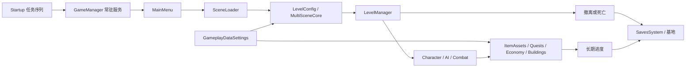

# 系统架构与运行流程

来源：本机 2.3.30；核心反编译路径 `local/decompiled/TeamSoda.Duckov.Core/`。下文列出的类名与方法可以在代码目录或检索页面查询，程序集/类型 token 见[类型地图](code-map.md)，IL 证据在 `local/code-metadata/` 与 `local/il/`。这是静态代码阅读所得流程；事件执行顺序与实际画面尚未运行核验。

## 1. 程序启动和生命周期

`Duckov.Tasks.Startup` 执行启动任务队列，先处理旧的 Save1–3、Options.ES3 与 Global 数据向 Saves 目录迁移，再等待启动序列，最后加载 MainMenu。构建场景列表的第一项为 Startup，随后为 MainMenu 和过场/基地等。不要直接把菜单所在 DLL 误判为业务入口。

`GameManager` 是跨场景单例，从 Resources 的 `GameManager` 键实例化，使用 DontDestroyOnLoad 保持。它聚合 AudioManager、UIInputManager、GameRulesManager、PauseMenu、SceneLoader、PlayerInput、ModManager、NoteIndex、AchievementManager 与 TimeScaleManager 等引用。DOTween 被设为不依赖常规游戏时间缩放；URP 调试界面被隐藏。组件中的引用关系与静态代码关系共同决定启动后的常驻服务。

## 2. 配置中心和场景组合

`Duckov.Utilities.GameplayDataSettings` 通过 Resources 加载同名配置；对象 `resources.assets:76721` 集中引用 tags、prefabs、uiPrefabs、itemAssets、layers、sceneManagement、buffs、quests、economyData、inputActions、buildingDataCollection、craftingFormulas、stockShopDatabase、cropDatabase、角色随机预设、对话与默认天赋树等。中心对象不是全部内容本体，而是入口清单。

`Duckov.Scenes.SceneLoader` 以 UniTask 组织加载、遮罩和前后回调；`SceneInfoCollection` 用稳定场景 ID 对接 Eflatun.SceneReference。55 条场景登记与 BuildSettings 的 63 个构建场景是两个不同维度。`MultiSceneCore` 的场景内数据还用于保持同次区域中的随机状态。

`LevelConfig` 决定基地/出击性质、是否保存角色/宠物、死亡是否生成墓箱、撤离点数量范围、账户可用性、季节、规则覆盖、掉落数量倍率与质量参数、启用天赋等，再创建 LevelManagerPrefab。16 个 LevelConfig 对象对应场景配置实例，不能凭数量推出玩家关卡数。

`LevelManager` 负责初始化规则、主角及其物品、AI、子弹、视野迷雾、时间、出口、宠物和结束流程。切换场景与结束出击的逻辑应从 SceneLoader、LevelConfig、LevelManager 三处共同阅读，不能只看单个 `LoadScene` 调用。

## 3. 玩家操作、动作与生存属性

`InputManager`、PlayerInput 与 `UIInputManager` 分别处理场景操作、输入动作和 UI 分派。`CharacterMainControl` 接收移动与瞄准，组织 CA_Run / CA_Dash 等动作，并连接装备、负重、耐力、能量与水分。动作状态与角色/物品属性共同影响操作，菜单暂停与时间缩放另有服务。

`ItemStatsSystem` 的 Item、StatCollection、ModifierDescriptionCollection、SlotCollection 和 Inventory 是业务复用层。角色本身也以 Item 配置承载属性与装备容器；ItemAssets 注册 ID 0 的角色模板已经可见。因此武器、角色、仓储和天赋可以通过同一种属性/容器接口互动。配置的基础值与装备/状态叠加后的实时值应分别查看。

## 4. 枪械、投射物与伤害

`ItemAgent_Gun` 通过物品属性查询伤害、射速/连发、弹速、距离、穿透、散布、后坐力、ADS、装填和容量等值；容量下限为 1，装填时间与 CharacterReloadSpeedGain 相连。`ItemSetting_Gun`、`ItemSetting_Bullet` 和附件设置决定物品级别的相关参数与事件，BulletPool 提供实例复用。

`Projectile.UpdateMoveAndCheck` 按帧推进速度与重力，单步时间最大取 0.04 秒，按最大射程截断移动距离；对本步路径执行 SphereCastAll 并按命中距离排序。命中检查包括阵营、已伤害对象、半高障碍、冲刺角色和原发射者等。对 DamageReceiver 组装伤害、元素、穿甲/破甲、暴击、Buff、出血和来源武器信息；有效命中消耗穿透计数，障碍/反弹分支另行处理。它是有移动路径的投射物逻辑，不能仅因瞄准阶段有射线就概括成即时命中武器。

`Health.Hurt` 排除加载、无敌和死亡状态，处理 Buff/出血与暴击，再选择头部或身体护甲及耐久损耗，应用规则、敌我和元素相关倍率，扣除生命并发出事件。具体护甲公式与注意点见[规则报告](rules-and-content.md)。`DamageReceiver` 是碰撞到生命系统之间的连接点。

## 5. AI 和敌人生成

`AICharacterController` 连接 NodeCanvas 行为树与 `AI_PathControl` 的 A* 寻路。角色预设含阵营、生命、模型、装备生成、视距/视角、反应延迟、夜间系数、巡逻/追踪/忘却距离、开火时段、技能与掉落配置。156 个 CharacterRandomPreset 涵盖普通敌人、特殊角色、炮台/载具与测试预设。

15 个行为树资产以 JSON `_serializedGraph` 保存节点类型、节点字段和连接，包含警戒、常规/近战战斗等图；另有 1 个任务关系图。业务 DLL 中的 `NodeCanvas.Tasks.Actions` / `Conditions` 实现叶节点动作，图选择流程，A* 负责位置路径。只看“敌人脚本”会遗漏图内规则；只看行为树会遗漏动作实现和角色预设。

`RandomCharacterSpawner` 与随机激活/加权选择组件属于场景侧布置。配置中 `isBoss` 有 61 个标记实例，但不同等级/场景版本可能对应同一种角色，不能当作最终内容数量或可达证明。

## 6. 搜索、掉落和背包

`Duckov.Utilities.LootBoxLoader` 先按 activeChance 决定容器激活，把位置量化后的键写入 MultiSceneCore 的 inLevelData，在同次区域数据中复用。Setup 结合固定物品概率、随机数量、关卡倍率以及显式物品池或 tag/品质过滤进行生成；Demo、Special 与 AdvancedDebuffMode 等标签参与排除。库存容量不足会扩充；放不进容器或设置 dropOnSpawnItem 时改为地面掉落。现金生成另有概率和区间。

5,653 个 LootBoxLoader 与 388 个物品生成配置是放置实例数量。随机容器的权重、条件和过滤结果才决定本次候选集；没有把这些实例都等同于独立掉落表。

背包/装备保存走 ItemTreeData 等树状数据，而不是仅存物品 ID。插槽、子物品、状态和装备修饰需要保持关联。物品条目中的 prefab、stats、slots、modifiers、inventory、agentPrefab 引用已经可以从对象索引逐个追踪。

## 7. 撤离、死亡与长期保存

`LevelManager.NotifyEvacuated` 设置无敌、发出撤离事件、保存主角、收集保存提供者数据并写文件。主角存储键包括 MainCharacterItemData 与 MainCharacterHealth；是否保存受 LevelConfig.SaveCharacter 限制。

死亡流程由 dieTask 防止重复进入；在适用的出击配置中记录死亡位置，按配置生成墓箱并过滤不可死亡掉落物品，再销毁/掉落物品，保存后延迟打开结束页面，通常回到基地；特殊场景结束路由可覆盖。掉落结果取决于关卡和物品属性，不是所有场景统一清空。

`Saves.SavesSystem` 将各系统写入 ES3 缓存文件；`OnCollectSaveData` 通知建筑、库存、任务、经济等提供者。槽号从 PlayerPrefs CurrentSlot 读取，默认 1；路径为 persistentDataPath 下的 `Saves/Save_{slot}.sav`，另有 Global.json 与选项文件。代码支持主备份 `.bac` 及超过五分钟间隔时轮换的 `.bac.01`–`.bac.10`，加载失败尝试备份，仍失败时重新初始化并发出恢复失败事件。这个流程不等于已证明断电原子性；未接触真实存档。

根据 `app.info` 的 TeamSoda / Duckov 与 Unity 路径规则，Windows 候选保存位置为 `%USERPROFILE%/AppData/LocalLow/TeamSoda/Duckov/Saves`；这是代码推定路径，未读取该目录验证。

## 8. 制作、建筑、商店和天赋

CraftingManager 通过 CraftingFormulaCollection 取配方，查询成本、支付，再创建产物送入库存/缓冲区并发出事件。配方可与天赋 UnlockFormula、设施和 UI 条件连接；不能把单独 Craft 方法的成本判断解释成所有解锁判断都在这个方法里。

BuildingManager 按区域保存建筑 ID、随机唯一 GUID、格坐标和旋转，占地格计算遇奇数旋转交换宽高。购买放置先检查配置与数量上限，优先消耗已回收建筑 token，否则支付成本，然后广播建筑事件；返回建筑把实体登记换回 token。碰撞/区域有效性还需看 BuildingArea、Building 与 BuilderView 调用边界。

StockShopDatabase 登记货表；StockShop 管理库存、概率刷新、UTC 刷新间隔与售卖价格，EconomyManager 处理账户和现金物品。基础价值经过货表 priceFactor 或卖出 sellFactor 取整；账户可用性由关卡配置影响。任务奖励、天赋与建筑事件可以解锁新货品/能力。

PerkTreeManager 与 Duckov.PerkTrees 类族组织天赋树、关系节点与需求；PerkBehaviour 实现修改基础属性、添加 Buff、解锁配方/成就、储藏扩容、菜园扩容和自动浇水等。163 个 Perk 实例不等同于 163 种独立效果实现。

## 9. 任务、剧情与附属内容

QuestManager 管理可接、活动、历史完成与检查状态；Quest 自身持有前置条件、任务和奖励。`MeetsPrerequisit` 检查等级、Demo 条件、任务关系图节点与所需完成 ID，随后逐个求值条件；配置存在而关系图没有节点的条目不能仅凭登记断言可接。`TryComplete` 要求子任务完成，奖励另有领取状态与自动领取逻辑。

522 个子任务引用包括交物品、击杀、任务事件、到达位置、建筑、撤离、天赋、存档条件等，也包含贪吃蛇、挖矿、泡泡和躲避小游戏分数/关卡任务。846 个奖励槽位（845 有效引用、1 原始空槽）主要为经验、金钱、物品和商店解锁。剧情、对话、便笺与触发器通过配置键、事件和序列化 UnityEvent 联系；本轮完整索引保留了这些对象，未逐段人工校对全部故事文本。

## 10. 天气、时间、画面、音频和平台

WeatherManager 保存随机 seed，使用 GameClock 的游戏时间、季节、降水与 Storm 状态计算晴/阴/雨/雪及风暴；强制天气开关另有优先分支。作物使用 DateTime.Now / ticks 计算浇水后增长，商店使用 DateTime.UtcNow 判断刷新，说明这些时间机制不能统一当作游戏内时间。

渲染相关程序集与实例包含 URP、Cinemachine、HBAO、视野迷雾、TastyGrassShader、ALINE / Shapes；动画、Timeline/PlayableDirector、粒子与烘焙光照数据均在对象目录。程序集存在仅证明打包依赖，具体场景使用要看组件引用。

AudioManager 将游戏事件路径对接 FMOD Studio 银行。本轮用 NOSOUND 读银行描述并解码样本，没有播放游戏事件；事件的分层、混音和参数到样本的完整关系尚未重建。

Duckov.Modding.ModManager / ModInfo 有本地 DLL 与 Steam Workshop 集成路径，Steamworks 与 Bilibili 平台库均在程序集目录；这些是集成边界证据，不说明当前安装同时启用了所有平台。未运行 Mods、联机服务、授权检查或平台写入操作。
