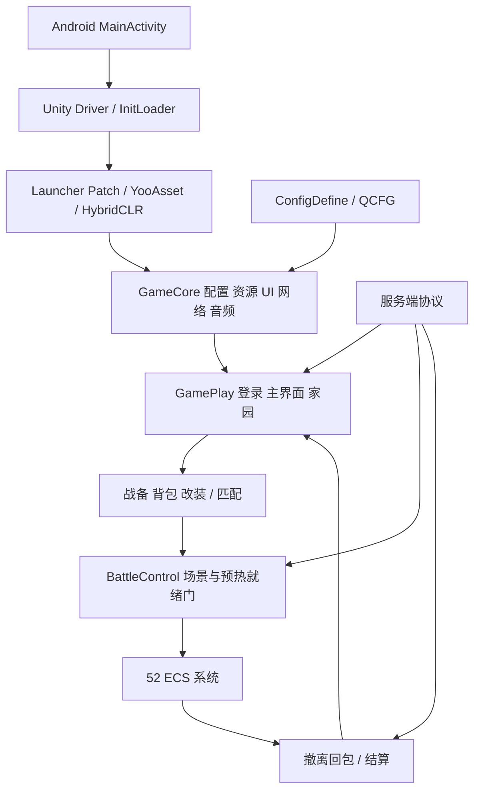

# 客户端架构与证据

2026-10-13。业务关系由实际 IL/C#、配置与对象确认，原生启动部分结合声明和局部反汇编。

## 加载与配置

MainActivity 启动 Unity；基础场景有 Launcher/SceneRoot。InitLoader 为 AOT，只有部分泛型 IL 和完整声明，不能冒称所有启动方法已恢复 C#。资源 DefaultPackage 1017 文件全在 APK；运行更新/下载未测试。

ResourcePayloadMixer.Apply 已局部反汇编：从 bundle 内部名和长度生成种子，以位置相关 xorshift 掩码转换流；981 文件全量恢复并验证。扩展清单整数由 ExtManifestAsset 声明确认为 DownloadPriority。

HotfixRuntimeConfig 的选择值 1 对应 ReleaseHotfix；依赖为 ConfigDefine → GameCore → GamePlay。两套镜像原样保留。QXPM 内部认证通过，没有修改运行配置或许可。

Preloader 优先检查 config_byte_0，顺序加载 0/1；BinaryConfigContainer/TableReader/KVReader 布局与实际 QCFG 对齐。ConfigMgr 通过生成绑定器读取 typed data_*。LangMgr 哈希对应语言 ID；SpriteConfigData 从 icon_conf 建立图集关系。

## 框架、网络和 ECS

GameCore 的 QXController/QXModel/QXManager、Singleton、EventMgr、UIMgr 组织模块。GamePlay 控制器处理回包、更新模型和界面事件；资源对象与 ui 表分别核对。

ProtoMap.Init 从 Protocol 嵌套类 Tag/is_battle 常量找到 Proto c2s/s2c 类型；NetNodeMgr.C2S 检查回放/连接准备后选择节点发送。KCP/native 接口存在，但服务端没有打包。不能由静态注册推断网络请求已运行。

BattleControl 单独维护场景加载、进入、预热、新手入场资格的门，满足后发送 battle_ready。EntityMgr 注册 52 系统；EcsWorld 顺序执行启用系统的 Update/LateUpdate，边界 Commands.Playback，Shutdown 逆序撤事件和销毁。不能假定与服务器同频或为固定步长模拟。

输入/武器/技能/移动之后，碰撞/状态/相机、准星/后坐力/散布、射击/子弹、动画/特效/Buff、建筑/引导/HUD各有系统。BulletSystem 用 speed×flyTime、range 算客户端位置，并对前后位置段做最近命中查询，处理枪口内碰撞、友方、墙体和本地反馈；最终服务器伤害不是该预测的同义词。

## 元游戏与中间件

MatchControl 根据回包设置状态/地图；BagControl 维护战场/仓库/临时战备；EvacuateControl 用 map_leave 与进入/退出/结算回包更新计时/CG/界面。Home、Workbench、任务和交易同样依赖回包更新。[细分阅读](systems.md)

URP、HybridRenderSystem、GPU Skinning、TerrainVT、DrawKeys、HCRH/SDF 属自定义渲染组织，原字节保留，未重建全部 LOD/遮挡/批处理或性能。FMOD 管理器与银行/样本对应，事件/混音及听感未运行。用户设置、缓存/回放和线上角色状态分别处理，PlayerPrefs 不能视为完整角色存档。
