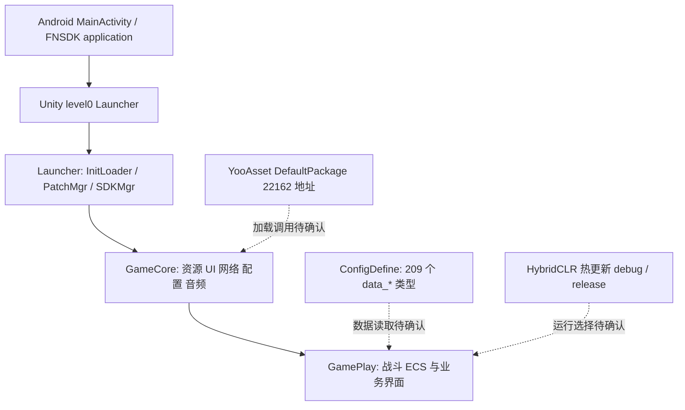

# 客户端架构证据图

2026-10-13。依据 manifest、程序集登记、MonoScript 身份与资源地址，未恢复业务方法体。分层关系是**名称与组织的推断**，不是已验证调用图。

## 入口与公共框架

manifest 的入口是 `com.zero.main.MainActivity`，Application 是 `com.ssjj.fnsdk.tool.crashcatch2.FNCrashCatchApplication`；`level0` 有 Launcher / SceneRoot。[identity](../evidence/identity.json)、[对象](../local/readable-objects.json)

Launcher 的类型有 InitLoader、PatchMgr、PatchCoroutineMgr、DLCDownloadMgr、SDKMgr、BundleStream、ResourcePayloadMixer。可以定位后续加载研究入口；本轮没有这些方法体，不能描述确切下载、封装算法或热更新选择。

GameCore 有 ResMgr、AssetLoadManager、PreloadMgr、ConfigMgr、UIMgr、UIAdaptMgr、LangMgr、SceneModelMgr、SoundMgr、FmodMgr、BankMgr；支持资源/配置/UI/声音分层的推断。同名类型按完整命名空间保留。[身份](../local/code-symbols.json)

## 战斗与业务

直接类型证据包括 `GamePlay.Battle.BattleControl`、`GamePlay.ECS.System.WeaponSystem`、BulletSystem、BuffSystem、AiMoveSystem、JumpMoveSystem、ShootInputSystem、SkillInputSystem、CrosshairInputSystem。包含 ECS 式组织；执行顺序、模拟频率、命中/伤害、联网同步未知。

BagControl、MatchControl、HomelandControl、部门/战场任务 Control，与背包、战备、撤离结果、建筑升级、改装、交易、工作台、技能树、回放预制体对应。确认模块被打包，不能以命名证明玩家可达、已开放或全部实现。

## 网络、渲染、音频与保存

IQNetClient、QKCPSocketClient、QNetPacketCoder、NetNodeMgr、KcpUpdateSystem、NetworkStatusMgr 和 `libmona_unity_qx_kcp.so` 是网络栈线索；Proto 中有 c2s / s2c 类型。协议字段、服务端实现和状态权威未恢复，没有发送服务端请求。

URP、HybridRenderSystem、GPUSkinning、TerrainVT 的登记与 16,499 DrawKeys 地址说明自定义渲染占重要部分。LOD、遮挡、质量档和性能仍需真实方法与运行证据。

FMODUnity、FMODUnityResonance、libfmodL、libfmodstudioL、libresonanceaudio 与 FMOD 资源目录相互印证音频中间件；事件参数、混音、并发、听感待验。

未读取存档或存储方法，不能用本仓 PC 原型保存合同推断这个 Android 客户端。测试/GM/记录/IngameAgent 类型存在不等于启用的入口或安全漏洞；本轮未运行这些功能。[程序集与初始化器](../evidence/code-summary.json)
